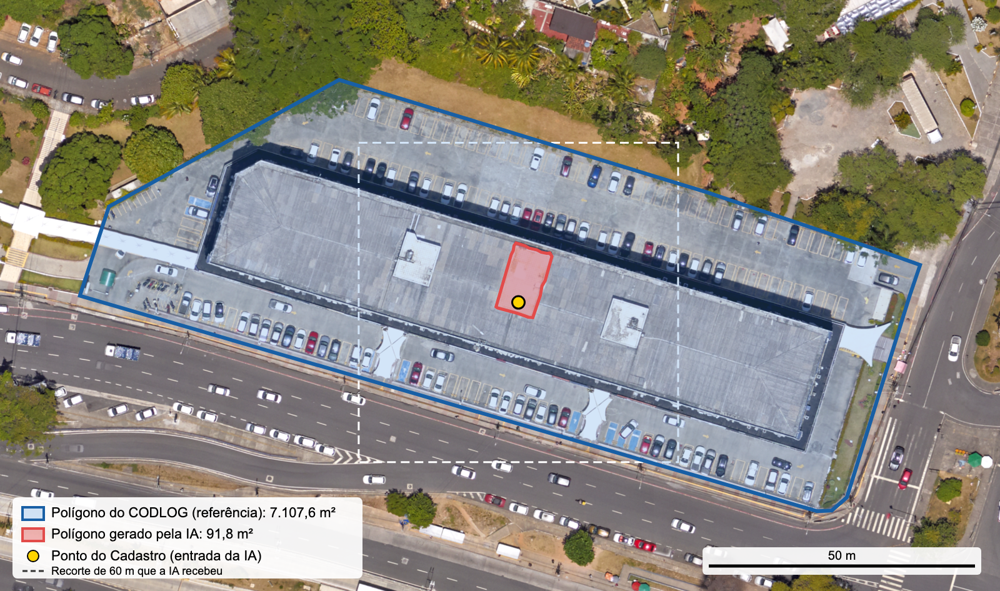
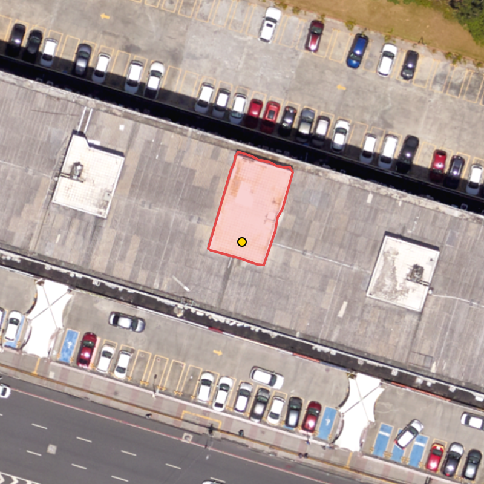
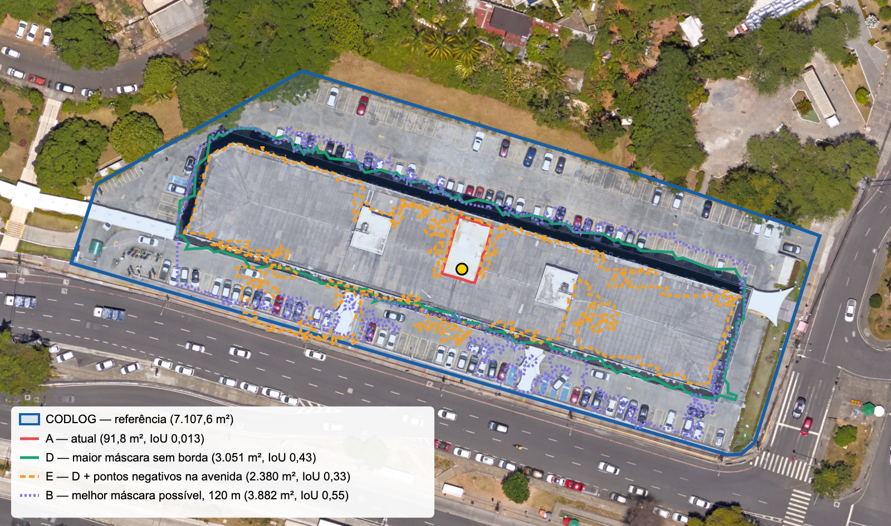

# Teste cego do contorno de lote por IA — 21/10/2026

Avalia se o contorno gerado pela IA do Viabiliza, a partir só da ortofoto, reproduz o lote cadastrado no endereçamento da SEDUR (CODLOG). O polígono do CODLOG foi aberto só depois de a IA terminar.

## Resultado em uma linha

A IA contornou uma estrutura de 91,8 m² sobre a laje do Edifício Maxcenter. O lote do CODLOG tem 7.107,6 m². O IoU foi 0,013. O contorno passou em todas as regras de aceite do sistema e, em produção, teria sido gravado como polígono do lote.

## Procedimento

| Etapa | O que foi feito |
|---|---|
| 1. Sorteio | No banco de produção, entre os 1.488 processos com lote do CODLOG (`address_polygon_source = chave`), ponto do Cadastro da SEFAZ (`property_location_source = cadastro_imobiliario`) e sem desenho do requerente, sorteio com `setseed(0.2110)` e `ORDER BY random()`. A semente foi fixada antes de ver o resultado. O comando devolveu só o ponto e o endereço, sem o polígono. |
| 2. Lote sorteado | Processo 1687 (VIA-2026-001685), CODLOG 2631 (Av. ACM), nº 846, complemento "LOTES 1 E 2 EDIF:MAXCENTER; SALA:0421". Ponto do Cadastro: −12,996143, −38,465385. |
| 3. Entrada da IA | Recorte da Ortofoto 2024 da Prefeitura (ImageServer, 7,5 cm/pixel), 60 m × 60 m em 800 × 800 px, centrado no ponto, e o ponto em pixels (400, 400). São os mesmos parâmetros e o mesmo cálculo do `OrtofotoClient`. Nenhuma geometria, coordenada ou medida do CODLOG foi usada. |
| 4. Execução | Serviço `footprint-ia` com o mesmo `app.py` da branch `feat/poligono-complementar-edificacoes`, SAM 2 no commit `2b90b9f5`, modelo `facebook/sam2.1-hiera-small` em CPU, chamada a `POST /segmentar`. Aceite pelas mesmas regras e constantes do `AceiteMascaraIa`. |
| 5. Registro | Resposta bruta do serviço e polígono georreferenciado gravados sem nenhum ajuste (`resposta_ia_bruta.json`, `resultado_ia.json`). |
| 6. Referência | Só depois disso: polígono do CODLOG 2631, nº 846, da camada `enderecamento:VM_ENDERECAMENTO` (feição única; contém o ponto do Cadastro). |
| 7. Comparação | PostGIS, em SIRGAS 2000 / UTM 24S (EPSG:31984). |

## Indicadores

| Indicador | Valor |
|---|---|
| Área do polígono do CODLOG | 7.107,6 m² |
| Área do polígono da IA | 91,8 m² |
| Diferença de área | −7.015,8 m² (−98,7%) |
| Área de interseção | 91,8 m² |
| IoU (interseção ÷ união) | **0,013** |
| Parte do polígono da IA dentro do lote | 100% |
| Parte do lote coberta pela IA | 1,3% |
| Distância de Hausdorff | 78,2 m |
| Deslocamento entre os centroides | 1,4 m |
| Perímetro: CODLOG / IA | 378,1 m / 39,5 m |
| Distância média dos vértices da IA até a divisa do lote | 20,8 m (mín. 19,5 m; máx. 25,9 m) |
| Distância média dos vértices do lote até o contorno da IA | 64,2 m |
| Aceite pelo sistema | Aceito (contém o ponto, 91,8 m² dentro de 20–5.000 m², compacidade 0,741 ≥ 0,2, não encosta na borda) |
| Score do modelo (IoU previsto pelo SAM) | 0,980 |
| Tempo de inferência | 7,6 s (CPU) |

## Análise das divergências

1. **A IA contornou o objeto errado.** O ponto do Cadastro caiu sobre a laje, ao lado de um volume técnico (casa de máquinas ou caixa-d'água). O SAM 2 recebe um único ponto e devolve a máscara de maior IoU previsto, que foi esse volume, com bordas nítidas e cor diferente da laje. O contorno é bom para o que contornou, mas não é o lote nem o edifício.
2. **O lote não cabe no recorte.** O lote tem cerca de 160 m × 80 m, e o recorte tem 60 m × 60 m. Mesmo que a IA escolhesse o edifício inteiro, o contorno encostaria na borda do recorte e seria recusado pela regra `encosta_na_borda`. O mesmo vale para qualquer lote maior que uns 55 m de lado.
3. **A IA contorna edificações, não lotes.** O serviço foi feito para achar a edificação que contém o ponto. Um lote inclui recuos, estacionamento e áreas livres, que não têm borda própria na imagem. Mesmo num acerto perfeito do prédio, a área ficaria bem abaixo da do lote.
4. **O aceite não detectou o erro.** O contorno passou em todas as regras: contém o ponto, tem área plausível e é compacto. O score de 0,98 também não ajuda: ele mede a confiança do SAM na máscara, não se a máscara é o lote. Em produção, esse polígono de 91,8 m² seria gravado como o lote do processo e usado na maior porção da zona.
5. **O ponto do Cadastro estava bom.** O ponto ficou a 1,4 m do centroide do lote. A divergência veio da segmentação, não da entrada.
6. **Coerência visual.** O polígono do CODLOG acompanha o limite visível do terreno (meio-fio da Av. ACM, borda do estacionamento e vegetação ao norte). O contorno da IA não acompanha nenhuma divisa do lote; todos os seus vértices ficam a 19–26 m da divisa mais próxima.

## Limites do teste

- Um único lote. Serve para mostrar um modo de falha, não para medir a taxa de acerto. Para uma estimativa, o mesmo procedimento deve ser repetido com uma amostra (por exemplo, 30 lotes, com a semente registrada).
- Lote comercial grande, maior que o recorte. Em lotes residenciais pequenos o resultado tende a ser diferente.
- Execução local em ARM (Apple), com o mesmo código e o mesmo modelo; produção roda em x86 no OKD.
- A referência foi lida da camada de endereçamento baixada em 21/10/2026. Para confirmar que é a mesma gravada no processo 1687, rode no pod: `php artisan tinker --execute 'echo json_encode(App\Models\ViabilityRequest::find(1687)->address_polygon_geojson),PHP_EOL;'`

## Achado à parte: a imagem da IA não monta como está

O `docker/footprint-ia/requirements-modelo.txt` da branch `feat/poligono-complementar-edificacoes` pede `sam2 @ …/2b90b9f5….zip`, mas o pacote desse commit se chama `SAM-2`, e o pip recusa a instalação ("inconsistent name"). Para este teste a imagem foi montada com `SAM-2 @ …` e `--no-build-isolation` (`Dockerfile-ia-local`), sem mudar o `app.py`. Vale corrigir na branch e conferir a versão publicada no SEMIT.

## Arquivos

| Arquivo | Conteúdo |
|---|---|
| `recorte.png`, `recorte.json` | Recorte da ortofoto entregue à IA e os parâmetros do recorte |
| `resposta_ia_bruta.json` | Resposta do serviço, sem tratamento (anel em pixels, score, modelo) |
| `resultado_ia.json` | Aceite, medidas e polígono da IA em EPSG:4326 |
| `referencia_codlog.geojson` | Polígono do CODLOG usado como referência |
| `metricas.json` | Indicadores calculados no PostGIS |
| `comparacao.png`, `ia_sobre_recorte.png` | Figuras |
| `executar_ia.py`, `Dockerfile-ia-local` | Script e imagem para repetir o teste |

## Experimento: ajustes de prompt e de escolha de máscara (itens 1 a 3)

Mesmo lote, mesmo modelo, sem o polígono do CODLOG como entrada (`experimento.py`, resultados em `experimento.json`). A área do terreno veio do Cadastro da SEFAZ pela inscrição 4006623: **36 m²** de terreno e 51 m² construídos. É a fração ideal da Sala 0421, não o terreno do edifício.

| Variante | O que muda | Recorte | Área | IoU | Lote coberto |
|---|---|:---:|---:|---:|---:|
| A — atual | 1 ponto, máscara de maior score | 60 m | 91,8 m² | 0,013 | 1,3% |
| C — área do Cadastro (item 1) | Máscara de área mais próxima de 36 m² | 60 m | 88,4 m² | 0,012 | 1,2% |
| D — maior máscara sem borda (item 2, sem área) | Recorte 60 → 120 → 240 m até a máscara não encostar na borda; fica a maior | 240 m | 3.051,4 m² | **0,429** | 42,9% |
| E — D + pontos negativos (item 3) | 6 pontos negativos no eixo da Av. ACM (CODLOG 2631) | 120 m | 2.379,7 m² | 0,332 | 33,3% |
| B — melhor máscara que o SAM chegou a gerar | Maior das 3 máscaras no recorte de 120 m | 120 m | 3.881,7 m² | 0,546 | 54,6% |
| Diagnóstico (não cego) | Caixa e escolha pela área real do lote (7.107,6 m²) | 240 m | 1.926,8 m² | 0,261 | 26,3% |

**Leitura**

- **Área do Cadastro (item 1) não serve em imóvel com várias unidades.** Para sala ou apartamento, a SEFAZ devolve a fração ideal da unidade (36 m² aqui), e escolher pela área piora o resultado. Ela só ajuda quando a inscrição é o lote inteiro (casa, terreno).
- **Recorte crescente sem área (item 2, variante D) é o maior ganho:** de 0,013 para 0,43 de IoU, contornando o edifício inteiro, sem usar nenhum dado do lote.
- **Pontos negativos na avenida (item 3) não ajudaram aqui:** o SAM encolheu a máscara para longe da via (0,33).
- **O teto do SAM neste lote é o edifício (0,55).** O estacionamento, os recuos e a vegetação dentro do lote não têm borda própria. Só um modelo treinado com lotes (item 4) pode aprender esse limite.
