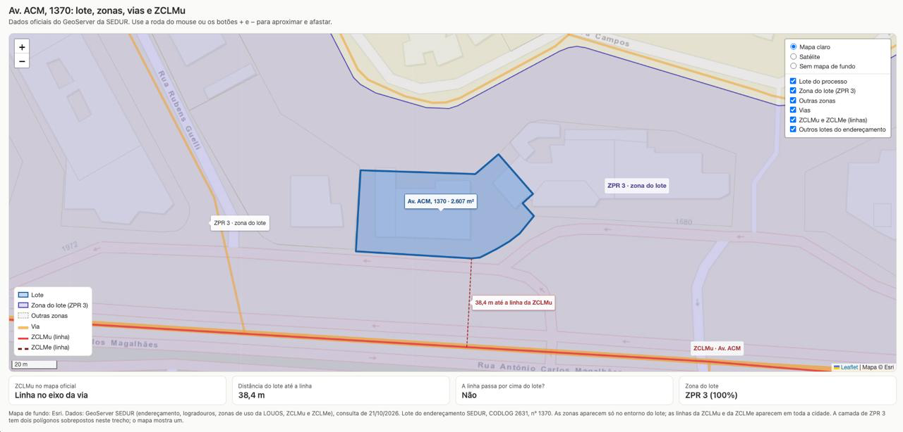
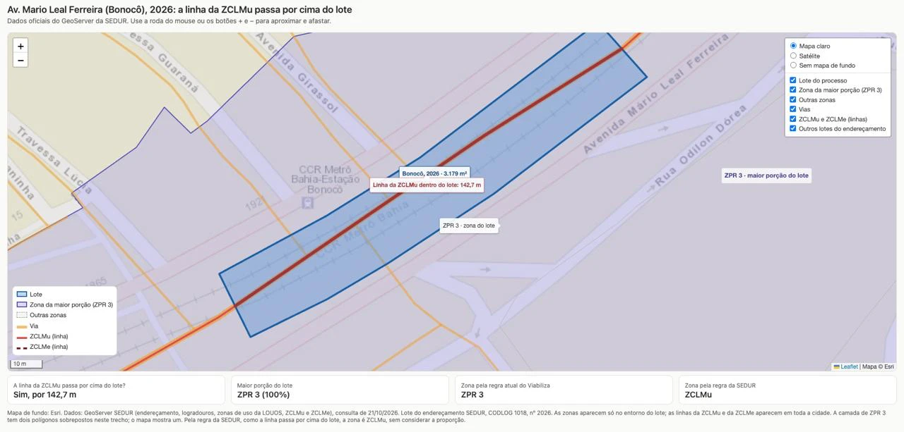
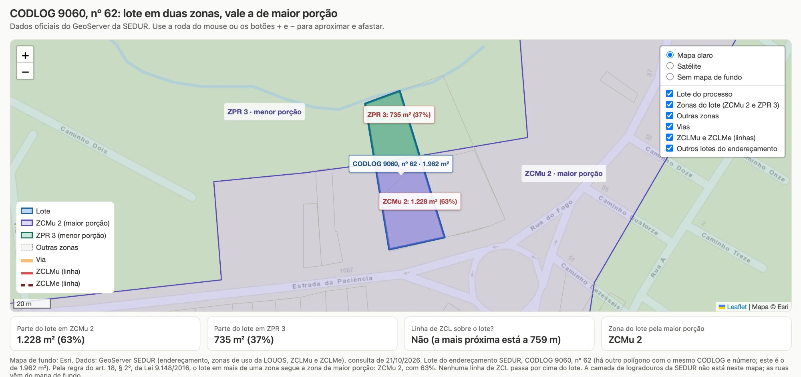

# HU.182 – DEFINIR A ZONA DO IMÓVEL PELA CENTRALIDADE LINEAR E PELA MAIOR PORÇÃO
**PROJETO: Viabiliza — Sistema de Licenciamento Eletrônico**

---

## Histórico de Revisão

| Data | Resumo das Alterações | Versão | Responsável |
|:---:|---|:---:|:---:|
| 21/10/2026 | Criação da HU para validação da regra com a SEDUR | 1.0 | Sudoeste Informática |
| 22/10/2026 | Incorporação do requisito RF-02 dos Requisitos para Homologação (21/10/2026): ZCLMu e ZCLMe nunca ocorrem juntas, cenários de teste de homologação e massa de teste | 1.1 | Sudoeste Informática |

---

## Visão Geral

O Viabiliza define a zona de uso do imóvel a partir do desenho do lote (o polígono do imóvel) e do mapa oficial de zonas da SEDUR. Essa zona decide se a atividade é permitida no endereço.

No mapa oficial da SEDUR, as Zonas de Centralidade Linear (ZCLMu e ZCLMe) **não são áreas**. Elas são uma **linha desenhada no meio da rua**, acompanhando o eixo da via. As demais zonas (ZPR, ZCMu, ZPAM, ZEIS e outras) são áreas.

Esta HU registra a regra combinada com a SEDUR:

1. **Centralidade Linear primeiro.** Se a linha da ZCLMu ou da ZCLMe passa por cima do lote, em qualquer parte dele, a zona do imóvel é a Zona de Centralidade Linear. A proporção do lote em outras zonas não importa.
2. **Maior porção depois.** Se nenhuma linha de Centralidade Linear passa por cima do lote, a zona do imóvel é a zona que ocupa a maior parte do lote (art. 18, § 2º, da Lei nº 9.148/2016).
3. **Lote de frente para a avenida não basta.** Se a linha passa em frente ao lote, mas não por cima dele, a Centralidade Linear não vale para aquele imóvel.

**O que isso significa na prática.** O lote termina na calçada e a linha da Centralidade Linear fica no meio da rua. Por isso a linha raramente passa por cima de um lote. Medição feita em 21/10/2026 com os dados oficiais:

| Base de imóveis | Imóveis | A linha da ZCLMu passa por cima | A linha da ZCLMe passa por cima |
|---|:---:|:---:|:---:|
| Endereçamento da SEDUR (lotes) | 47.398 | 9 | 0 |
| Parcelamento de lotes da SEDUR | 26.907 | 2 | 0 |
| Edificações Overture (prédios) | 642.876 | 50 | 13 |

Nos casos conferidos no satélite, a linha só passa por cima quando o desenho do lote invade a própria via, como no Exemplo 2 desta HU.

---

## Sumário

- [Épico: EP13 — Integrações](#épico-ep13--integrações)
- [História de Usuário](#história-de-usuário-definir-a-zona-do-imóvel)
- [Regras](#regras)
- [Exemplos com dados reais](#exemplos-com-dados-reais)
- [Pré-requisitos](#pré-requisitos)
- [Dependências](#dependências)
- [Comportamento Esperado](#comportamento-esperado)
- [Pontos para validação da SEDUR](#pontos-para-validação-da-sedur)
- [Aprovação do Requisito](#aprovação-do-requisito)

---

## Épico: EP13 — Integrações

**Como** analista **quero** que a zona do imóvel venha do mapa oficial da SEDUR **, de modo que** o enquadramento da atividade use a zona certa

## História de Usuário: Definir a zona do imóvel

**Como** analista **quero** que o sistema aplique primeiro a Zona de Centralidade Linear, quando a linha dela passa por cima do lote, e depois a zona de maior porção do lote **, de modo que** a zona do processo siga a regra da SEDUR e eu entenda, só de olhar o mapa, por que aquela zona foi escolhida

---

## Regras

| Nº | Situação do lote | Zona do imóvel |
|:---:|---|---|
| RN-01 | A linha da ZCLMu passa por cima do lote, em qualquer parte | ZCLMu |
| RN-02 | A linha da ZCLMe passa por cima do lote, em qualquer parte | ZCLMe |
| RN-03 | Nenhuma linha de Centralidade Linear passa por cima do lote, e o lote está em uma zona só | Essa zona |
| RN-04 | Nenhuma linha de Centralidade Linear passa por cima do lote, e o lote está em mais de uma zona | A zona que ocupa a maior parte do lote |
| RN-05 | A linha de Centralidade Linear passa em frente ao lote, mas não por cima dele | Não é Centralidade Linear; aplica-se RN-03 ou RN-04 |
| RN-06 | Duas zonas ocupam exatamente a mesma área do lote | O processo vai para análise técnica |
| RN-07 | As linhas da ZCLMu e da ZCLMe passam por cima do mesmo lote (cenário que o negócio considera inexistente) | O processo vai para análise técnica |

Na RN-01 e na RN-02, o percentual do lote em outras zonas não é considerado.

**Origem e alinhamento com o RF-02.** O requisito RF-02 dos Requisitos para Homologação (21/10/2026) diz que, quando o polígono está em mais de uma zona, a Centralidade Linear é a referência, mesmo que ocupe 1% do imóvel. Como a linha não tem área, a linha que passa por cima do lote conta como uma segunda zona do lote. Assim, um lote 100% em ZPR 3 com a linha por cima já está em duas zonas e fica com a Centralidade Linear (Exemplo 2). Sem linha por cima e com uma zona só, o comportamento atual é mantido (RN-03).

**ZCLMu e ZCLMe juntas.** O negócio informou que o lote não fica em ZCLMu e ZCLMe ao mesmo tempo. Se o mapa mostrar as duas linhas sobre o mesmo lote, o processo vai para análise técnica com o nome das duas zonas no motivo (RN-07).

---

## Exemplos com dados reais

Os três mapas abaixo foram montados com os dados oficiais do GeoServer da SEDUR, consultados em 21/10/2026. Em todos, o lote aparece em azul, as zonas em tons de roxo e verde, as vias em amarelo e a linha da ZCLMu em vermelho.

### Exemplo 1 — A linha passa em frente ao lote, mas não por cima (RN-05)

Av. ACM, 1370 (CODLOG 2631), lote de 2.607 m². A linha da ZCLMu está no meio da avenida, a 38,4 m do lote. O lote está 100% em ZPR 3.

**Resultado: ZPR 3.** A linha da Centralidade Linear não passa por cima do lote.

### Exemplo 2 — A linha passa por cima do lote (RN-01)

Av. Mario Leal Ferreira (Bonocô), 2026 (CODLOG 1018), polígono de 3.179 m². A linha da ZCLMu corre 142,7 m por dentro do polígono. O polígono está 100% em ZPR 3.

**Resultado: ZCLMu.** A linha passa por cima do polígono, então a Centralidade Linear prevalece sobre a ZPR 3, mesmo com 100% do polígono em ZPR 3.

Observação: este polígono é uma faixa no canteiro central da avenida, junto à Estação Bonocô do metrô. É um exemplo de desenho que invade a via.

### Exemplo 3 — Lote em duas zonas, sem Centralidade Linear (RN-04)

Lote do endereçamento CODLOG 9060, nº 62, na Estrada da Paciência, com 1.962 m². Uma parte está em ZCMu 2 e outra em ZPR 3. A linha de Centralidade Linear mais próxima está a 759 m.

| Zona | Parte do lote | Percentual |
|---|:---:|:---:|
| ZCMu 2 | 1.228 m² | 63% |
| ZPR 3 | 735 m² | 37% |

**Resultado: ZCMu 2**, a zona de maior porção.

---

## Pré-requisitos

- Polígono do lote no processo (endereçamento da SEDUR, cadastro de lotes da SEMAP ou edificação de base complementar)
- Camadas de zona da SEDUR disponíveis, incluindo ZCLMu e ZCLMe

## Dependências

**Passadas**

- HU.108 — Integrar com GIS Municipal (consulta ao mapa oficial e polígono do lote)

**Futuras**

- Exibição, no mapa do processo, do lote, das zonas, das vias e da linha da Centralidade Linear, com o motivo da zona escolhida

---

## Comportamento Esperado

**Cenário 1: A linha da Centralidade Linear passa por cima do lote**
**Dado que** a linha da ZCLMu passa por cima de qualquer parte do lote
**E** a maior parte do lote está em outra zona
**Quando** o processo identifica a zona
**Então** a zona gravada é ZCLMu
**E** o mapa do processo mostra a linha passando por cima do lote

**Cenário 2: A linha passa em frente ao lote**
**Dado que** a linha da ZCLMu passa na avenida em frente ao lote, sem tocar nele
**Quando** o processo identifica a zona
**Então** a ZCLMu não é aplicada
**E** a zona gravada é a da maior porção do lote

**Cenário 3: Lote em duas zonas, sem Centralidade Linear**
**Dado que** nenhuma linha de Centralidade Linear passa por cima do lote
**E** o lote tem 63% em ZCMu 2 e 37% em ZPR 3
**Quando** o processo identifica a zona
**Então** a zona gravada é ZCMu 2
**E** o mapa mostra a área e o percentual de cada parte do lote

**Cenário 4: Empate entre zonas**
**Dado que** duas zonas ocupam a mesma área do lote
**Quando** o processo identifica a zona
**Então** nenhuma zona é escolhida por desempate
**E** o processo vai para análise técnica com o nome das duas zonas no motivo

**Cenário 5: Linhas da ZCLMu e da ZCLMe sobre o mesmo lote**
**Dado que** as linhas da ZCLMu e da ZCLMe passam por cima do mesmo lote
**Quando** o processo identifica a zona
**Então** o processo vai para análise técnica com o nome das duas zonas no motivo
**E** o caso serve de alerta, pois o negócio informou que ele não existe

**Cenário 6: Lote em uma zona só, com a linha por cima**
**Dado que** o lote está 100% em ZPR 3
**E** a linha da ZCLMe passa por cima de qualquer parte dele
**Quando** o processo identifica a zona
**Então** a zona gravada é ZCLMe

**Cenário 7: Lote em uma zona só, sem Centralidade Linear**
**Dado que** o lote está em uma zona só
**E** nenhuma linha de Centralidade Linear passa por cima dele
**Quando** o processo identifica a zona
**Então** a zona gravada é essa zona, como hoje

---

## Cenários de teste para homologação

Os cenários Z1 a Z6 do RF-02 foram traduzidos para a regra da linha por cima do lote, porque a Centralidade Linear não tem área e, portanto, não tem percentual.

| # | Cenário do RF-02 | Como testar | Resultado esperado |
|:---:|---|---|---|
| Z1 | 50% ZCLMu / 50% outra zona | Lote com a linha da ZCLMu por cima e metade em outra zona | ZCLMu |
| Z2 | 90% outra zona / 10% ZCLMe | Lote com a linha da ZCLMe por cima e o restante em outra zona | ZCLMe |
| Z3 | 99% outra zona / 1% ZCLMu | Lote 100% em ZPR 3 com a linha da ZCLMu por cima (Exemplo 2) | ZCLMu |
| Z4 | Duas zonas, nenhuma de Centralidade Linear | Lote em ZCMu 2 e ZPR 3, sem linha por cima (Exemplo 3) | Maior porção, como hoje |
| Z5 | Uma única zona | Lote 100% em ZPR 3, sem linha por cima (Exemplo 1) | ZPR 3, como hoje |
| Z6 | ZCLMu e ZCLMe ao mesmo tempo | Lote com as duas linhas por cima | Análise técnica (RN-07) |

**Massa de teste.** Com o mapa oficial, só 9 lotes do endereçamento são cruzados pela ZCLMu e nenhum pela ZCLMe. Para Z2 e Z6 será preciso desenhar polígonos de teste que cruzem a linha da ZCLMe e as duas linhas, ou usar as edificações do Overture (13 cruzadas pela ZCLMe). Os polígonos de teste devem cobrir a ZCLMu, a ZCLMe e zonas vizinhas.

---

## Pontos para validação da SEDUR

1. **Linha por cima do lote.** Está correto que só é Zona de Centralidade Linear quando a linha passa por cima do lote, e que o lote de frente para a avenida, sem ser tocado pela linha, fica com a outra zona? (Sim / Não)
2. **Distância máxima.** Se a resposta ao ponto 1 for "Não", qual é a distância máxima, em metros, entre a linha e o lote para que ele seja considerado da Centralidade Linear? Para referência: na Av. ACM, os lotes de frente para a avenida ficam de 37 a 58 m da linha; nas medições com o mesmo logradouro da linha, a maioria fica a até 30 m.
3. **ZCLMe.** Está de acordo que, com o mapa atual, a ZCLMe não se aplica a nenhum lote do endereçamento? (Sim / Não)
4. **ZCLMu e ZCLMe juntas.** Respondido no RF-02: o negócio informou que o caso não existe. Mantém-se o envio para análise técnica como proteção (RN-07). A SEDUR confirma? (Sim / Não)
5. **Imóvel sem desenho do lote.** Quando o imóvel tem só um ponto no mapa, sem polígono, o sistema mantém a zona onde o ponto está ou manda o processo para análise técnica?

---

## Aprovação do Requisito

A Sudoeste Informática esclarece que o desenvolvimento das funcionalidades descritas neste documento foi realizado de acordo com os requisitos e especificações fornecidos pelo cliente. Nossa equipe seguiu rigorosamente as instruções recebidas, garantindo que o sistema esteja alinhado com o que foi solicitado.

Para evitar possíveis retrabalhos ou ajustes futuros, sugerimos que o cliente revise atentamente os requisitos apresentados, verificando se eles atendem plenamente às suas necessidades e expectativas, bem como se estão em conformidade com eventuais normas aplicáveis ao seu negócio.

Reafirmamos nosso compromisso de entregar um software de qualidade que agregue valor às operações do cliente, e a validação cuidadosa dos requisitos é um passo importante para garantir o sucesso do projeto.

| Data | Setor | Nome | Assinatura |
|------|-------|------|------------|
|      |       |      |            |
|      |       |      |            |
|      |       |      |            |
